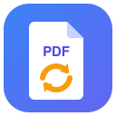
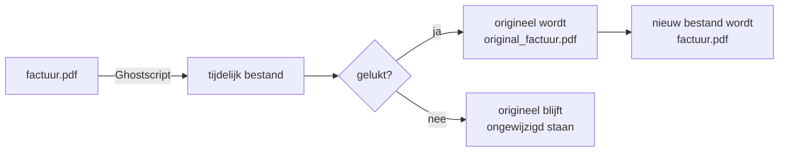

<div align="center">



# pdf-convert

**Zet PDF's opnieuw om met Ghostscript, zonder ooit een origineel kwijt te raken.**

Handig om afwijkende of slecht opgebouwde PDF's te normaliseren naar nette PDF 1.7.

[](https://github.com/jebr/pdf-convert/actions/workflows/ci.yml)
[](https://github.com/jebr/pdf-convert/actions/workflows/powershell.yml)
[](https://github.com/jebr/pdf-convert/actions/workflows/codeql.yml)
<br>


[Snel aan de slag](#-snel-aan-de-slag) •
[Python](#-gebruik-met-python) •
[PowerShell](#-gebruik-met-powershell) •
[Hoe het werkt](#-hoe-het-werkt) •
[Beveiliging](#-beveiliging) •
[Ontwikkelen](#-ontwikkelen)

</div>

---

## ✨ Kenmerken

- 🛟 **Origineel blijft altijd bewaard** als `original_<naam>.pdf`, ook als er halverwege iets misgaat
- 📂 **Bestanden en mappen door elkaar**, zoveel als je wilt in één opdracht
- 🔁 **Veilig opnieuw te draaien**: al verwerkte bestanden worden herkend en overgeslagen
- 🔒 **Veilig standaard**: Ghostscript met `-dSAFER`, geen shell, time-out per bestand
- 🪟 **Twee versies met dezelfde werking**: Python en PowerShell

| Versie | Bestand | Geschikt voor |
| :-- | :-- | :-- |
| 🐍 Python | [`convertpdf.py`](convertpdf.py) | macOS en Linux, of Windows met Python |
| 💠 PowerShell | [`ConvertPdf.ps1`](ConvertPdf.ps1) | Windows zonder Python (5.1 of 7), ook PowerShell 7 op macOS en Linux |

## 🚀 Snel aan de slag

**1. Installeer Ghostscript** (nodig voor beide versies)

| Systeem | Installeren |
| :-- | :-- |
| 🪟 Windows | 64-bit installer van [ghostscript.com/releases](https://ghostscript.com/releases/gsdnld.html), of `choco install ghostscript` |
| 🍎 macOS | `brew install ghostscript` |
| 🐧 Debian/Ubuntu | `sudo apt install ghostscript` |

**2. Zet je PDF's om**

```bash
./convertpdf.py ~/Scans                        # Python
```

```powershell
.\ConvertPdf.ps1 'C:\Scans'                    # PowerShell
```

> [!TIP]
> Probeer het eerst op een kopie van een paar PDF's. Je originelen blijven bewaard, maar zo zie
> je meteen hoe het resultaat eruitziet.

## 🐍 Gebruik met Python

Vereist Python 3.10 of nieuwer. Er zijn geen extra pakketten nodig.

```bash
./convertpdf.py "/pad/naar/map"                         # alle PDF's in een map
./convertpdf.py "/pad/naar/factuur.pdf"                 # een los bestand
./convertpdf.py ~/Scans ~/Archief "/tmp/brief.pdf"      # mix van mappen en bestanden
./convertpdf.py ~/Scans/*.pdf                           # jokertekens via je shell
./convertpdf.py "/pad/naar/map" --timeout 600           # max. seconden per bestand
./convertpdf.py --help
```

| Optie | Uitleg | Standaard |
| :-- | :-- | :-- |
| `pad ...` | Een of meer PDF-bestanden en/of mappen | verplicht |
| `--timeout` | Maximale tijd per bestand in seconden | `300` |

## 💠 Gebruik met PowerShell

Werkt met Windows PowerShell 5.1 (standaard op Windows 10 en 11) en met PowerShell 7 op
Windows, macOS en Linux. Python is niet nodig.

### Eenmalig instellen op Windows

1. Installeer Ghostscript (zie [Snel aan de slag](#-snel-aan-de-slag)).
2. Zet `ConvertPdf.ps1` in een vaste map. In de voorbeelden is dat `C:\Tools`; vervang dat door
   je eigen map, bijvoorbeeld de map waar je de repo hebt gekloond.
3. Sta lokale scripts toe voor je eigen account:

   ```powershell
   Set-ExecutionPolicy -Scope CurrentUser -ExecutionPolicy RemoteSigned
   ```

4. Bekijk het script en geef het daarna vrij:

   ```powershell
   Unblock-File C:\Tools\ConvertPdf.ps1
   ```

> [!IMPORTANT]
> Op Windows 10 en 11 staat de execution policy standaard op `Restricted`: dan draait geen
> enkel script. Zet hem op `RemoteSigned` zoals hierboven, en liever niet op `Bypass` of
> `Unrestricted`.

### Script uitvoeren

```powershell
cd C:\Tools
.\ConvertPdf.ps1 'C:\Scans'                                  # alle PDF's in een map
.\ConvertPdf.ps1 'C:\Scans\factuur.pdf'                      # een los bestand
.\ConvertPdf.ps1 'C:\Scans' 'D:\Archief' 'C:\Temp\brief.pdf'  # mix van mappen en bestanden
```

Zo ziet de uitvoer eruit:

```text
Overgeslagen: 'C:\Scans\notities.txt' is geen PDF.
Omzetten: C:\Scans\factuur.pdf
Klaar: 'original_factuur.pdf' (origineel) en 'factuur.pdf' (nieuw).
Afgerond: 1 omgezet, 0 mislukt, 1 overgeslagen.
```

| Parameter | Uitleg | Standaard |
| :-- | :-- | :-- |
| `-Path` | Een of meer PDF-bestanden en/of mappen. De naam `-Path` mag je weglaten | verplicht |
| `-TimeoutSeconds` | Maximale tijd per bestand in seconden | `300` |
| `-GhostscriptPath` | Volledig pad naar `gswin64c.exe`, als Ghostscript niet vanzelf gevonden wordt | automatisch |

Ghostscript wordt gezocht in `PATH` en daarna in `C:\Program Files\gs\<versie>\bin`, waar de
Windows-installer het neerzet. Alle uitleg staat ook in het script zelf:
`Get-Help .\ConvertPdf.ps1 -Detailed`.

> [!NOTE]
> PowerShell vouwt jokertekens als `*.pdf` niet vanzelf uit voor een script. Maak een selectie
> met `Get-ChildItem`:
>
> ```powershell
> .\ConvertPdf.ps1 (Get-ChildItem 'C:\Scans\factuur*.pdf').FullName
> ```

<details>
<summary><b>Meer tips voor PowerShell</b></summary>
<br>

- Zet een pad met spaties tussen aanhalingstekens: `'C:\Mijn scans'`.
- Met `-Path` erbij scheid je meerdere paden met komma's:
  `-Path 'C:\Scans','C:\Temp\brief.pdf'`.
- Starten vanuit de opdrachtprompt of de Taakplanner:

  ```bat
  powershell.exe -NoProfile -File "C:\Tools\ConvertPdf.ps1" "C:\Scans" "C:\Temp\brief.pdf"
  ```

  Gebruik `pwsh.exe` in plaats van `powershell.exe` als je PowerShell 7 hebt.

</details>

## ⚙️ Hoe het werkt

Voor elk opgegeven PDF-bestand en elke `*.pdf` direct in een opgegeven map (geen submappen):



Gaat het plaatsen van het nieuwe bestand mis, of breek je het script af, dan wordt het origineel
teruggezet. Daarna gaat het script door met het volgende bestand.

**Overgeslagen** (met een melding bij losse bestanden):

- bestanden zonder `.pdf`-extensie
- bestanden die al met `original_` beginnen
- symlinks
- in mappen: submappen en verborgen bestanden

Een PDF die je meerdere keren noemt (los en via zijn map), wordt maar één keer verwerkt.

<details>
<summary><b>Exit codes</b></summary>
<br>

| Code | Betekenis |
| :-: | :-- |
| `0` | Alles gelukt. Overgeslagen bestanden tellen niet als fout |
| `1` | Minstens één bestand mislukt, een pad bestaat niet, of een fout vooraf (bijvoorbeeld Ghostscript niet gevonden). Een PDF waarvoor al een `original_` bestaat, telt ook als mislukt |
| `2` | Geen pad of ongeldige argumenten opgegeven |
| `130` | Afgebroken met Ctrl+C (alleen Python) |

</details>

## 🔒 Beveiliging

| Maatregel | Waarom |
| :-- | :-- |
| Ghostscript met `-dSAFER` | Een kwaadaardige PDF kan geen bestanden lezen of schrijven buiten de opdracht |
| Geen shell | Het commando gaat als argumentenlijst naar Ghostscript, er is geen ruimte voor injectie |
| Absolute paden | Een bestandsnaam als `-x.pdf` wordt nooit als optie gelezen; `%` wordt ge-escaped |
| Symlinks overslaan | Er wordt niets buiten de opgegeven map of het opgegeven bestand aangepast |
| Time-out per bestand | Een vastlopende of extreem zware PDF houdt de rest niet tegen |

> [!WARNING]
> Kwetsbaarheden in Ghostscript zelf zijn het grootste risico bij PDF's van onbekende herkomst.
> Houd Ghostscript up-to-date; de losse Windows-installer werkt zichzelf niet bij.

## 🛠️ Ontwikkelen

<details>
<summary><b>Python: tests en controles</b></summary>
<br>

```bash
python -m venv .venv && source .venv/bin/activate
pip install -e ".[dev]"
pytest                    # integratietests alleen als Ghostscript aanwezig is
ruff check . && ruff format --check .
mypy
bandit -c pyproject.toml -r convertpdf.py
```

</details>

<details>
<summary><b>PowerShell: tests en controles</b></summary>
<br>

Vereist [Pester 5](https://pester.dev) en PSScriptAnalyzer.

```powershell
Invoke-Pester ./tests
Invoke-ScriptAnalyzer -Path ./ConvertPdf.ps1 -Settings ./PSScriptAnalyzerSettings.psd1
```

</details>

**Continuous integration** bij elke pull request:

| Workflow | Wat het controleert |
| :-- | :-- |
| CI | ruff, mypy, Bandit, pip-audit en pytest op Linux en macOS, Python 3.10 t/m 3.13, met echte Ghostscript |
| PowerShell | PSScriptAnalyzer en Pester op Windows PowerShell 5.1, PowerShell 7 (Windows) en PowerShell 7 (Linux), met echte Ghostscript |
| CodeQL | Security-scan van Python en de workflows, ook wekelijks |

Dependabot houdt de GitHub Actions en Python-afhankelijkheden bij.
